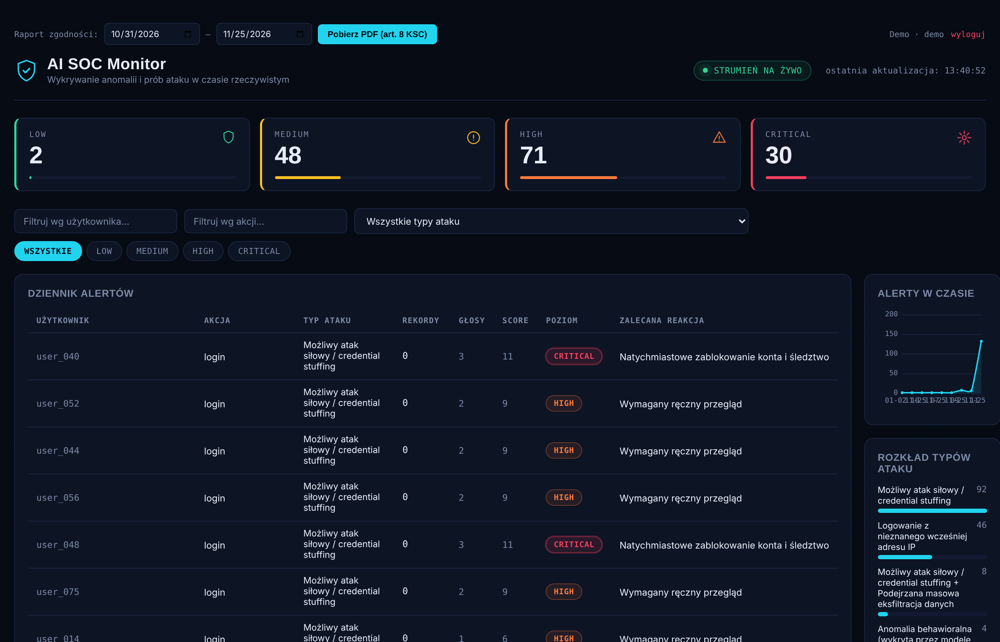

# AI SOC Monitor

> **Status: prototype under active development — not production-ready.**
> This repository is the second iteration of a prototype that started as my engineering
> thesis project (Computer Science, *IT in business processes*, PANS Ciechanów, 2026).
> The first version was a proof of concept; this iteration hardens it, fixes the
> security and correctness problems I found when auditing my own code, and documents
> what is still missing. See [Known limitations](#known-limitations) before using it for anything real.
>
> Polish version: [README.pl.md](README.pl.md)

A small multi-tenant security-monitoring service: it ingests activity events (logins,
exports, record changes), detects suspicious behaviour with **detection rules + unsupervised
ML**, scores each alert, shows it on a live dashboard and generates a PDF compliance report
(structured for NIS2 / the Polish KSC act, art. 8 incident-handling evidence).



*Screenshot: dashboard on fully synthetic data produced by `generate_activity.py`.*

## What it does

- **Three ways to get data in**, all going through one validation/normalization function (`events.py`):
  web upload of CSV/JSON with automatic column mapping the operator can correct before commit,
  a machine-to-machine API (`POST /api/v1/events`, per-tenant API key), and a folder watcher (`collector.py`).
- **Smart import**: columns are mapped to `timestamp / actor / action / ip / status / records` by content
  and name heuristics, assigned with the Hungarian algorithm; low confidence → human review.
- **Detection**: five rules (brute force per source IP, export-volume bursts, increasing recon pattern,
  privileged account activity at night, login from a new IP) plus IsolationForest, LOF and DBSCAN.
  Details and an *indicative* MITRE ATT&CK mapping: [docs/DETECTION.md](docs/DETECTION.md).
- **Scoring** LOW → CRITICAL from model votes, rule weights, action risk, account privilege and time of day.
- **Multi-tenancy**: every table carries `tenant_id`; the tenant comes from the session, never from request parameters.
- **PDF compliance report** for a chosen period.

## Architecture

```
 CSV/JSON upload ─┐
 REST + API key  ─┼─> events.normalize_event ─> SQLite (WAL) ─> ai_monitor.py ─> alerts ─> dashboard (Flask :5001)
 collector.py    ─┘       (bi_server :5000)                      rules + IF/LOF/DBSCAN          └─> PDF report
```

Three processes share one SQLite database: `bi_server` (ingest, :5000), `ai_dashboard` (:5001), `ai_monitor` (detection loop).

## Quick start (local)

```bash
python -m venv .venv && source .venv/bin/activate
pip install -r requirements.txt
export SOC_SECRET_KEY=$(python -c "import secrets; print(secrets.token_hex(32))")
cd app
python manage.py create-tenant "Demo company" "demo"      # prints the API key ONCE
python manage.py create-user 1 demo.operator              # asks for a password (min. 12 chars)
python ai_monitor.py &                                    # detection loop
python ai_dashboard.py &                                  # http://127.0.0.1:5001
python bi_server.py &                                     # http://127.0.0.1:5000
python generate_activity.py 1 --count 500 --fast --seed 1 # synthetic traffic incl. attack scenarios
```

Docker + automatic TLS: [docs/DEPLOY.md](docs/DEPLOY.md). Tests: `pip install -r requirements-dev.txt && pytest`.

## Security work done on the prototype

The previous version had real issues that I reproduced and fixed (each has a regression test where practical):

| Area | Problem in v1 | Now |
|---|---|---|
| Secrets | Fallback to a hard-coded session key when none was set | App refuses to start without `SOC_SECRET_KEY` (≥ 32 chars) |
| API keys | Stored in plaintext | SHA-256 hash, shown once, rotation command, legacy keys migrated |
| Passwords | No length policy; passwords passed on the command line | ≥ 12 chars; prompt or env var; constant-time check also for unknown users |
| Brute force | No throttling | DB-backed limits per user+IP, IP, user (login) and per IP (API key) |
| CSRF | None | Session token on every state-changing request |
| XSS | Event data rendered unescaped | Escaping + CSP with per-request nonce; no third-party CDN/fonts |
| Open redirect | `next=` followed blindly | Only same-app relative paths |
| Import | Guessable sequential tokens, any user could commit | Random, TTL, bound to user+tenant, count-limited |
| Input | Invalid/NaT/absurd timestamps could poison the pipeline | Every event validated; rejected ones counted |
| Detection | One shared cursor across tenants could skip events; one bad tenant blocked everyone | Per-tenant persisted cursor; per-tenant error isolation |
| Container | Root user, dev server | Non-root, gunicorn, health check, dropped capabilities |

CI (`.github/workflows/ci.yml`) runs pytest, bandit, pip-audit, gitleaks and a Trivy image scan; Dependabot is enabled.
Vulnerability reporting: [SECURITY.md](SECURITY.md).

## Known limitations

Honest list of what this prototype does **not** do well yet:

- **No measured detection quality.** There is no labelled dataset, so no precision/recall. Tests check that rules fire and the pipeline behaves, not that detection is *good*. All demo data is synthetic.
- **DBSCAN runs only on the current micro-batch**, so its output depends on batch size and is not a stable signal.
- **Train/serve skew** in the ML features (e.g. per-actor activity counts are computed differently at training and scoring time), and `LabelEncoder` is refit on retraining, so model inputs can shift between retrains.
- **Brute-force rule is per source IP only**; a distributed low-and-slow attack from many IPs is not caught by it.
- **Rule window state is in memory** and lost on monitor restart (the cursor is persisted, the windows are not).
- **Roles are stored but not enforced** — every authenticated user of a tenant has the same rights.
- **Sessions are stateless cookies** — they cannot be revoked server-side before they expire.
- **Ambiguous dates** such as `03/04/2026` are parsed month-first.
- **Single-node design**: SQLite, in-memory pending imports (hence one gunicorn worker), dashboard polling every 2 s. Not horizontally scalable.
- **No audit log** of operator actions, no MFA, no password reset flow.
- The MITRE ATT&CK mapping is indicative, not a validated detection-engineering mapping.

Planned next steps are tracked in the issues; the first ones are a labelled evaluation script, persisted rule windows and role enforcement.

## Repository layout

```
app/        application code (Flask apps, monitor, collector, CLI)
tests/      pytest suite (web security, ingest, DB, monitor)
docs/       deployment guide, detection notes, screenshot
```

## License

MIT — see [LICENSE](LICENSE). Not affiliated with any employer; contains no company data.
