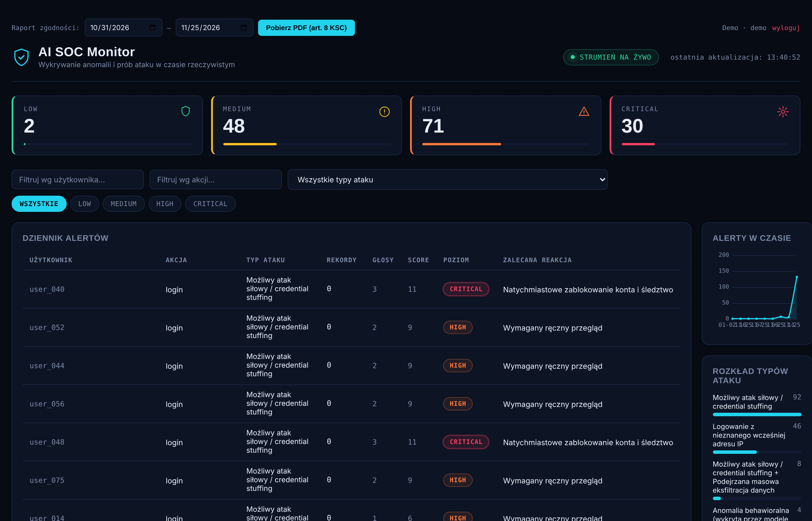

# AI SOC Monitor

> **Status: prototyp w rozwoju — nie do użytku produkcyjnego.**
> To druga iteracja prototypu, który powstał jako projekt inżynierski (Informatyka,
> specjalizacja *Informatyka w procesach biznesowych*, PANS Ciechanów, 2026). Pierwsza wersja
> była proof of concept; ta utwardza ją, naprawia błędy bezpieczeństwa i poprawności znalezione
> w audycie własnego kodu i uczciwie opisuje, czego jeszcze brakuje. Przed jakimkolwiek
> realnym użyciem przeczytaj sekcję [Znane ograniczenia](#znane-ograniczenia).
>
> English version: [README.md](README.md)

Wielodostępowy (multi-tenant) serwis monitorowania bezpieczeństwa: przyjmuje zdarzenia
aktywności (logowania, eksporty, zmiany rekordów), wykrywa podejrzane zachowania
**regułami + uczeniem nienadzorowanym**, ocenia alerty (LOW–CRITICAL), pokazuje je na
dashboardzie na żywo i generuje raport zgodności PDF (art. 8 KSC).



*Zrzut: dane w pełni syntetyczne z `generate_activity.py`.*

## Co robi

- **Trzy drogi wprowadzania danych**, wszystkie przez jedną walidację (`events.py`): upload CSV/JSON z automatycznym
  mapowaniem kolumn (operator może poprawić przed zatwierdzeniem), API (`POST /api/v1/events`, klucz API tenanta), watcher folderu (`collector.py`).
- **Detekcja**: 5 reguł (brute force z jednego IP, serie dużych eksportów, narastający rekonesans, aktywność
  uprzywilejowanego konta w nocy, logowanie z nowego IP) + IsolationForest, LOF, DBSCAN. Szczegóły: [docs/DETECTION.md](docs/DETECTION.md).
- **Izolacja tenantów**: `tenant_id` pochodzi z sesji, nigdy z parametrów żądania.
- **Raport PDF** za wybrany okres.

## Szybki start

```bash
python -m venv .venv && source .venv/bin/activate
pip install -r requirements.txt
export SOC_SECRET_KEY=$(python -c "import secrets; print(secrets.token_hex(32))")
cd app
python manage.py create-tenant "Firma demo" "demo"     # klucz API wyświetlany RAZ
python manage.py create-user 1 operator.demo           # hasło pytane interaktywnie (min. 12 znaków)
python ai_monitor.py & python ai_dashboard.py & python bi_server.py &
python generate_activity.py 1 --count 500 --fast --seed 1
```

Wdrożenie z Dockerem i TLS: [docs/DEPLOY.md](docs/DEPLOY.md). Testy: `pip install -r requirements-dev.txt && pytest`.

## Znane ograniczenia

- Brak zmierzonej jakości detekcji (brak etykietowanych danych, brak precision/recall); dane demo są syntetyczne.
- DBSCAN działa tylko na bieżącej mikro-partii — wynik zależy od jej rozmiaru.
- Rozjazd cech ML między treningiem a oceną (np. licznik aktywności aktora); `LabelEncoder` jest trenowany od nowa przy każdym retreningu.
- Reguła brute force liczy per adres IP — atak rozproszony z wielu IP jej umyka.
- Okna reguł są w pamięci i znikają po restarcie monitora (kursor jest zapisywany).
- Role są zapisywane, ale nie egzekwowane; sesje są bezstanowe (nie da się ich unieważnić przed wygaśnięciem).
- Niejednoznaczne daty (`03/04/2026`) są czytane jako miesiąc-dzień.
- Architektura jednowęzłowa (SQLite, importy w pamięci procesu → jeden worker gunicorna).
- Brak logu audytowego, MFA i resetu hasła. Mapowanie MITRE ATT&CK jest orientacyjne.

## Zrobione zabezpieczenia

Hasła ≥ 12 znaków, klucze API jako skróty, limity prób logowania, CSRF, CSP z nonce (bez CDN), ochrona przed open redirect,
walidacja każdego zdarzenia, izolacja błędów między tenantami, kontener bez roota. Pełna tabela „było → jest”: [README.md](README.md#security-work-done-on-the-prototype).

## Licencja

MIT. Projekt nie zawiera danych żadnej firmy ani pracodawcy.
